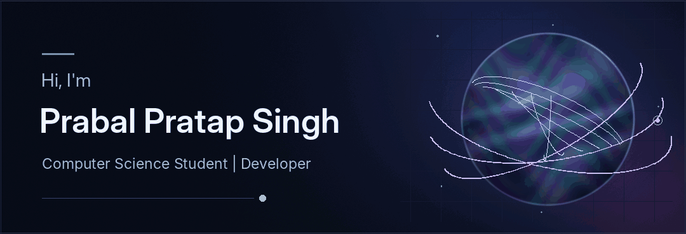
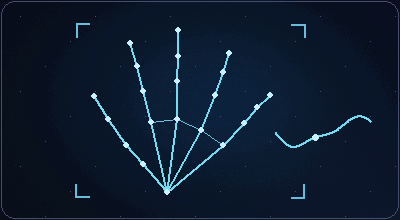

<picture>
  <source media="(prefers-reduced-motion: reduce)" srcset="./assets/hero.png" />
  
</picture>

 

I'm a Computer Science student interested in cybersecurity,  
problem solving, Web security, Cloud Security, Network Security

 

## What I Know

`Python` &nbsp; `SQL` &nbsp; `Git` &nbsp; `GitHub` &nbsp; `Linux` &nbsp; `HTML` &nbsp; `C` &nbsp; `CSS` &nbsp; `JavaScript`

 

## Currently Learning

<table>
  <tr>
    <td>Data Structures &amp; Algorithms</td>
    <td>javascript</td>
    <td>golang</td>
  </tr>
  <tr>
    <td>rust</td>
    <td>docker</td>
    <td>kubernets</td>
  </tr>
  <tr>
    <td>nodejs</td>
    <td>reactjs</td>
    <td>react</td>
  </tr>
  <tr>
    <td>redis</td>
    <td>postgresql</td>
    <td>Java</td>
  </tr>
  <tr>
    <td>AI/ML</td>
    <td>Network Security</td>
    <td>Cloud Computing</td>
  </tr>
</table>

 

## Major Projects

<table>
  <tr>
    <td width="59%" valign="middle">
      <h3>AI Sign Language Translator</h3>
      
Real-time sign language recognition using computer vision and machine learning.

    </td>
    <td width="41%" valign="middle">
      <picture>
  <source media="(prefers-reduced-motion: reduce)" srcset="./assets/sign.png" />
  
</picture>
    </td>
  </tr>
  <tr>
    <td width="59%" valign="middle">
      <h3>Argus-Shell</h3>
      
Unix shell written in python

    </td>
    <td width="41%" valign="middle">
      <picture>
  <source media="(prefers-reduced-motion: reduce)" srcset="./assets/shell.png" />
  
</picture>
    </td>
  </tr>
  <tr>
    <td width="59%" valign="middle">
      <h3>Truth-Lens</h3>
      
An Ai featured application which identifies whether a message which came on your whatsapp or anywhere is valid or not

    </td>
    <td width="41%" valign="middle">
      <picture>
  <source media="(prefers-reduced-motion: reduce)" srcset="./assets/lens.png" />
  
</picture>
    </td>
  </tr>
</table>

 

## Connect with me:

&nbsp;

 

## Languages and Tools:

  &nbsp;&nbsp;
  &nbsp;&nbsp;
  &nbsp;&nbsp;
  &nbsp;&nbsp;
  &nbsp;&nbsp;
  &nbsp;&nbsp;
  &nbsp;&nbsp;
  &nbsp;&nbsp;
  &nbsp;&nbsp;
  &nbsp;&nbsp;
  &nbsp;&nbsp;
  &nbsp;&nbsp;
  &nbsp;&nbsp;
  &nbsp;&nbsp;
  &nbsp;&nbsp;
  &nbsp;&nbsp;
  &nbsp;&nbsp;
  &nbsp;&nbsp;

 

